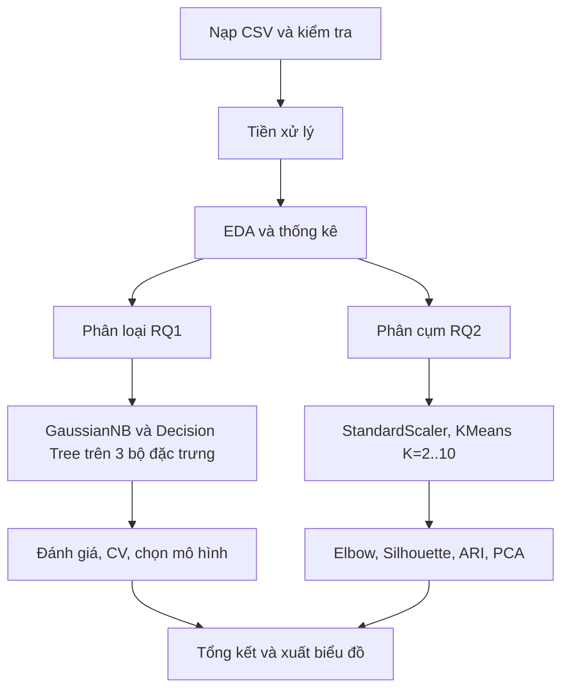

# ARCHITECTURE - Kiến trúc kỹ thuật

## 1. Công nghệ

| Thư viện | Vai trò |
|---|---|
| Python 3.10+ | Ngôn ngữ chính |
| Pandas, NumPy | Đọc, làm sạch và thống kê dữ liệu |
| Scikit-Learn | GaussianNB, DecisionTreeClassifier, KMeans, StandardScaler, PCA, các chỉ số đánh giá, cross-validation |
| Matplotlib, Seaborn | Trực quan hóa |

Ngoài các thư viện trên, chỉ dùng thư viện chuẩn của Python (`os`, `sys`, `warnings`).

## 2. Cấu trúc thư mục

```
Data-Mining-09/
├── dry_beans.csv     # dữ liệu gốc (đặt thủ công)
├── main.py           # script duy nhất
├── outputs/          # PNG DPI 300, tự tạo khi chạy
└── Planing/          # 6 file tài liệu .md
```

## 3. Cấu trúc `main.py`

Một file duy nhất, chia khối bằng comment và hàm.

Hằng số ở đầu file: `RANDOM_STATE = 42`, `DATA_PATH`, `OUTPUT_DIR`, `TEST_SIZE = 0.2`, `CV_FOLDS = 5`, `K_RANGE = range(2, 11)`, danh sách nhóm đặc trưng kích thước và hình dạng, bản đồ màu theo lớp.

## 4. Data Pipeline

1. **Nạp dữ liệu:** kiểm tra file tồn tại, đủ cột. Nếu lỗi thì dừng và báo bằng tiếng Việt.
2. **Tiền xử lý:** kiểm tra thiếu, loại dòng trùng, kiểm tra kiểu dữ liệu, phát hiện ngoại lai bằng IQR (chỉ báo cáo, giữ nguyên).
3. **EDA:**
   - Thống kê mô tả: mean, median, std, phân vị.
   - Đơn biến: histogram, boxplot, KDE.
   - Đa biến: ma trận tương quan và heatmap.
   - Phân bố lớp.
4. **Phân loại (RQ1):**
   - Chia 80/20 có `stratify`.
   - Chạy GaussianNB và Decision Tree trên 3 bộ đặc trưng: tất cả, kích thước, hình dạng.
   - Đánh giá: Accuracy, F1-macro, classification report, Confusion Matrix, 5-fold stratified CV.
   - Lấy `feature_importances_` của Decision Tree.
   - Chọn mô hình tốt nhất.
5. **Phân cụm (RQ2):**
   - `StandardScaler` rồi KMeans với K từ 2 đến 10.
   - Elbow (inertia) và Silhouette để chọn K.
   - Fit K tối ưu, crosstab và ARI so với nhãn thật.
   - Chiếu PCA 2D để vẽ cụm.
6. **Tổng kết:** in bảng so sánh và trả lời RQ1, RQ2 ra console. Lưu toàn bộ hình vào `outputs/`.

## 5. Sơ đồ luồng



## 6. Quy ước dữ liệu giữa các bước

- Dữ liệu thô giữ nguyên cho Naive Bayes và Decision Tree.
- Dữ liệu chuẩn hóa chỉ dùng cho K-Means và PCA.
- Nhãn `Class` không đưa vào K-Means. Nó chỉ dùng để đánh giá sau khi phân cụm.
