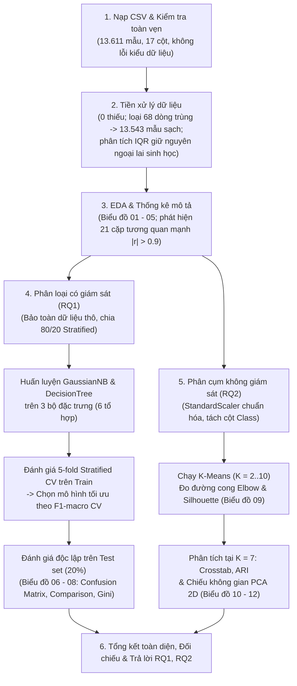

# Khai phá Dữ liệu - Phân loại và Phân cụm Đậu khô (Dry Bean Dataset)


-2EA44F)


> **Tóm tắt mục tiêu:** Xây dựng quy trình khai phá dữ liệu (*Data Mining Pipeline*) hoàn chỉnh và có tính tất định, tái lập 100% trên tập dữ liệu **Dry Bean Dataset** (13.611 mẫu gốc, 16 đặc trưng hình thái học, 7 giống đậu thương phẩm). Dự án triển khai đồng bộ trên cả tệp mã nguồn độc lập [`main.py`](main.py) và sổ tay tương tác học thuật [`dry_beans.ipynb`](dry_beans.ipynb), đi xuyên suốt từ khâu thẩm định tính toàn vẹn dữ liệu, tiền xử lý (kiểm tra khuyết thiếu, loại bỏ trùng lặp, phân tích ngoại lai theo IQR), phân tích khám phá dữ liệu (EDA đơn biến và đa biến), đến mô hình hóa giải quyết hai bài toán nghiên cứu cốt lõi: **Học có giám sát** (`GaussianNB`, `DecisionTreeClassifier`) và **Học không giám sát** (`KMeans`, `PCA 2D`).

---

## 1. Thông tin chung

- **Học phần:** Khai thác dữ liệu và ứng dụng (Mã học phần: `841447`)
- **Nhóm sinh viên thực hiện (Nhóm 9):**
  - **Trương Chí Long** — MSSV: `3123410198`
  - **Bùi Anh Đức** — MSSV: `3124720016`
- **Giảng viên hướng dẫn:** ThS. **Nguyễn Thanh Phước**
- **Đơn vị đào tạo:** Khoa Công nghệ Thông tin — Trường Đại học Sài Gòn (SGU)

---

## 2. Kiến trúc & Cấu trúc dự án

### 2.1. Cấu trúc cây thư mục hiện tại

```text
Data-Mining-09/
├── dry_beans.csv                 # Tệp dữ liệu gốc Dry Bean Dataset (13.611 mẫu × 17 thuộc tính)
├── main.py                       # Script Python trọn luồng toàn bộ pipeline tự động (chuẩn PEP 8)
├── dry_beans.ipynb               # Sổ tay Jupyter Notebook báo cáo học thuật (kèm kết quả & 12 biểu đồ inline)
├── README.md                     # Báo cáo tổng kết toàn diện, số liệu thực nghiệm và hướng dẫn tái lập
└── outputs/                      # Thư mục lưu trữ 12 biểu đồ PNG chất lượng cao (chuẩn 300 DPI)
    ├── 01_phan_bo_lop.png        # Biểu đồ phân bố 7 giống đậu sau làm sạch
    ├── 02_histogram_dac_trung.png# Lưới 4×4 Histogram & KDE của 16 đặc trưng số
    ├── 03_boxplot_ngoai_lai.png  # Lưới 4×4 Boxplot trực quan hóa ngoại lai IQR
    ├── 04_ma_tran_tuong_quan.png # Heatmap ma trận tương quan Pearson (21 cặp |r| > 0.9)
    ├── 05_boxplot_theo_lop.png   # So sánh phân bố đặc trưng tiêu biểu qua 7 lớp
    ├── 06_confusion_matrix.png   # Ma trận nhầm lẫn của Decision Tree tốt nhất trên Test set
    ├── 07_so_sanh_mo_hinh.png    # Biểu đồ so sánh hiệu năng 6 tổ hợp mô hình phân loại
    ├── 08_feature_importances.png# Trọng số tầm quan trọng Gini Importance của Decision Tree
    ├── 09_elbow_silhouette.png   # Đường cong Elbow (Inertia) & Silhouette Score cho K = 2..10
    ├── 10_crosstab_cum_lop.png   # Heatmap ma trận chéo (Crosstab) đối chiếu 7 cụm với 7 lớp thật
    ├── 11_pca_cum.png            # Không gian PCA 2D trực quan hóa cấu trúc 7 cụm K-Means
    └── 12_pca_lop_that.png       # Không gian PCA 2D phân bố theo 7 nhãn giống đậu thực tế
```

**Mô tả vai trò các thành phần cốt lõi:**
1. [`dry_beans.csv`](dry_beans.csv): Dữ liệu đầu vào thu nhận từ hệ thống thị giác máy tính của Koklu & Ozkan (2020), gồm 13.611 hạt đậu thuộc 7 giống (`BARBUNYA`, `BOMBAY`, `CALI`, `DERMASON`, `HOROZ`, `SEKER`, `SIRA`) với 16 đặc trưng hình thái số.
2. [`main.py`](main.py): Pipeline dòng lệnh độc lập viết bằng Python chuẩn PEP 8. Tự động kiểm tra file, làm sạch dữ liệu, trực quan hóa EDA, huấn luyện chéo 5-fold, đánh giá kiểm tra, phân cụm không giám sát và xuất 12 biểu đồ độ phân giải 300 DPI.
3. [`dry_beans.ipynb`](dry_beans.ipynb): Sổ tay Jupyter Notebook phục vụ báo cáo đồ án và trình diễn tương tác, được biên soạn chi tiết theo chuẩn học thuật với 6 phần lớn, nhúng sẵn toàn bộ bảng dữ liệu, công thức toán học và 12 biểu đồ trực quan inline.
4. [`outputs/`](outputs/): Thư mục đầu ra chứa toàn bộ 12 hình ảnh phân tích định dạng PNG 300 DPI với style `seaborn-v0_8-whitegrid`, font `DejaVu Sans` và bảng màu `tab10` chuẩn hóa đồng nhất.

### 2.2. Luồng xử lý dữ liệu (Data Pipeline Architecture)



### 2.3. Môi trường công nghệ & Thư viện sử dụng

| Công nghệ / Thư viện | Phiên bản khuyến nghị | Vai trò chi tiết trong pipeline |
|---|---|---|
| **Python** | `3.10+` | Ngôn ngữ thực thi chính cho cả script CLI (`main.py`) và notebook (`dry_beans.ipynb`) |
| **Pandas** | `2.0+` | Đọc nạp CSV, tiền xử lý, kiểm tra khuyết thiếu, khử trùng lặp, lập bảng Crosstab |
| **NumPy** | `1.24+` | Tính toán số học mảng, ma trận tương quan Pearson, thống kê phân vị IQR |
| **Scikit-Learn** | `1.2+` | Thuật toán `GaussianNB`, `DecisionTreeClassifier`, `KMeans`, `StandardScaler`, `PCA`, `StratifiedKFold`, `cross_validate`, `classification_report`, `confusion_matrix`, `silhouette_score`, `adjusted_rand_score` |
| **Matplotlib** | `3.7+` | Thiết lập khung vẽ đồ thị, xuất ảnh PNG 300 DPI (`dpi=300`, `bbox_inches="tight"`) |
| **Seaborn** | `0.12+` | Trực quan hóa thống kê nâng cao (KDE, Boxplot, Heatmap tương quan và nhầm lẫn) |

---

## 3. Hai câu hỏi nghiên cứu cốt lõi (Research Questions)

| Mã | Bài toán | Câu hỏi nghiên cứu | Phương pháp luận thực nghiệm |
|---|---|---|---|
| **RQ1** | **Phân loại có giám sát** (*Supervised Classification*) | Dựa vào nhóm đặc trưng nào — **kích thước** (`Area`, `Perimeter`, ...) hay **hình dạng** (`roundness`, `ShapeFactor`, ...) — để xác định giống đậu chính xác hơn? | • Phân chia tập Train/Test theo tỷ lệ `80/20` có phân tầng (`stratify=y`, `RANDOM_STATE = 42`). Bảo toàn dữ liệu gốc, không chuẩn hóa cho Naive Bayes và Decision Tree.<br>• Phân chia không gian 16 đặc trưng thành: **Nhóm Kích thước (8 đặc trưng)**: `Area`, `Perimeter`, `MajorAxisLength`, `MinorAxisLength`, `AspectRation`, `Eccentricity`, `ConvexArea`, `EquivDiameter` và **Nhóm Hình dạng (8 đặc trưng)**: `Extent`, `Solidity`, `roundness`, `Compactness`, `ShapeFactor1`, `ShapeFactor2`, `ShapeFactor3`, `ShapeFactor4`.<br>• Huấn luyện và đánh giá **6 tổ hợp** qua **5-fold Stratified Cross-Validation** trên tập Train.<br>• Chọn mô hình có **F1-macro CV cao nhất**, kiểm chứng khách quan một lần trên tập Test (20%), phân tích ma trận nhầm lẫn và xếp hạng tầm quan trọng đặc trưng Gini. |
| **RQ2** | **Phân cụm không giám sát** (*Unsupervised Clustering*) | Số cụm tự nhiên tối ưu của thuật toán **K-Means** là bao nhiêu, và các cụm tìm được có khớp với **7 giống đậu thực tế** không? | • Chuẩn hóa toàn diện 16 đặc trưng số trên 13.543 mẫu sạch bằng `StandardScaler`, loại bỏ hoàn toàn nhãn `Class` khỏi quá trình gom cụm.<br>• Thực thi `KMeans` (`n_init=10`, `random_state=42`) với dải số cụm $K \in [2..10]$.<br>• Xác định $K$ tối ưu dựa trên điểm gãy **Elbow (Inertia/WCSS)** và giá trị cực đại của **Silhouette Score**.<br>• Tại mốc đối chiếu $K = 7$, đánh giá mức độ tương thích với nhãn thực tế thông qua ma trận chéo **Crosstab**, chỉ số **Adjusted Rand Index (ARI)** và trực quan hóa phép chiếu giảm chiều **PCA 2D**. |

---

## 4. Tóm tắt kết quả thực nghiệm chi tiết

> **Ghi chú tái lập:** Tất cả số liệu dưới đây được đo lường trực tiếp từ quá trình chạy thực tế của [`main.py`](main.py) và [`dry_beans.ipynb`](dry_beans.ipynb) với tham số ngẫu nhiên cố định `RANDOM_STATE = 42`, đảm bảo độ chính xác tuyệt đối đến 4 chữ số thập phân (`.4f`).

### 4.1. Tiền xử lý dữ liệu & Khám phá EDA
- **Hiện trạng dữ liệu ban đầu:** `13.611` mẫu $\times$ `17` cột (gồm 2 cột `int64`, 14 cột `float64` và 1 cột nhãn chuỗi `Class`).
- **Phân bố 7 lớp gốc:** `DERMASON`: 3.546 (26,05%), `SIRA`: 2.636 (19,37%), `SEKER`: 2.027 (14,89%), `HOROZ`: 1.928 (14,17%), `CALI`: 1.630 (11,98%), `BARBUNYA`: 1.322 (9,71%), `BOMBAY`: 522 (3,84%).
- **Làm sạch dữ liệu:**
  - **Giá trị khuyết thiếu (NaN):** Ghi nhận **0** giá trị thiếu trên toàn bộ bảng dữ liệu.
  - **Dữ liệu trùng lặp:** Phát hiện và loại bỏ chính xác **68 dòng trùng lặp hoàn toàn** (toàn bộ 68 dòng trùng đều thuộc lớp `HOROZ`, đưa lớp này từ 1.928 xuống còn 1.860 mẫu).
  - **Tập dữ liệu sạch:** **13.543 mẫu** $\rightarrow$ Chia Train/Test 80/20: `Train = 10.834` mẫu (80,00%), `Test = 2.709` mẫu (20,00%), tỷ lệ phân bố 7 lớp được bảo toàn hoàn hảo trên cả hai tập.
- **Phát hiện ngoại lai theo phân vị IQR ($1.5 \times \text{IQR}$):**
  - Ghi nhận **3.004 / 13.543 mẫu (22,18%)** có ít nhất một đặc trưng vượt ngưỡng biên IQR.
  - Tỷ lệ ngoại lai cao nhất tập trung ở: `Eccentricity` (833 mẫu - 6,15%), `Solidity` (774 mẫu - 5,72%), `ShapeFactor4` (760 mẫu - 5,61%), `MinorAxisLength` (567 mẫu - 4,19%), `Area` (551 mẫu - 4,07%); thấp nhất là `ShapeFactor2` (0 mẫu - 0,00%).
  - **Quyết định học thuật:** **Giữ nguyên 100% mẫu ngoại lai**. Các giá trị vượt biên không phải do lỗi nhập liệu mà phản ánh tính biến thiên sinh học tự nhiên giữa các giống đậu (như giống `BOMBAY` có diện tích hạt khổng lồ gấp 5–7 lần giống hạt nhỏ `DERMASON`).
- **Hiện tượng đa cộng tuyến cao ($|r| > 0.9$):**
  - Xác định **21 cặp đặc trưng** có tương quan Pearson rất mạnh ($|r| > 0.9$).
  - Các cặp tương quan cao nhất: `Area` – `ConvexArea` ($r = 0.9999$), `Compactness` – `ShapeFactor3` ($r = 0.9987$), `Perimeter` – `EquivDiameter` ($r = 0.9915$) và `AspectRation` – `Compactness` ($r = -0.9876$). Hiện tượng này gây suy giảm nghiêm trọng giả định độc lập có điều kiện của thuật toán Naive Bayes khi sử dụng nhóm kích thước.

---

### 4.2. Kết quả RQ1: Hiệu năng Phân loại 7 giống đậu khô

#### Bảng so sánh toàn diện 6 tổ hợp mô hình qua 5-fold Stratified CV và Test Set

| Thuật toán | Bộ đặc trưng sử dụng | F1-macro CV (Train) | Accuracy CV (Train) | Test Accuracy | Test F1-macro |
|---|---|---:|---:|---:|---:|
| `GaussianNB` | Toàn bộ (16 đặc trưng) | `0.7632 ± 0.0085` | `0.7620 ± 0.0073` | `0.7630` | `0.7669` |
| `GaussianNB` | Nhóm Kích thước (8 đặc trưng) | `0.7625 ± 0.0080` | `0.7612 ± 0.0068` | `0.7619` | `0.7659` |
| `GaussianNB` | Nhóm Hình dạng (8 đặc trưng) | `0.9062 ± 0.0067` | `0.8916 ± 0.0082` | `0.8915` | `0.9060` |
| `Decision Tree` | Toàn bộ (16 đặc trưng) | `0.9107 ± 0.0046` | `0.8960 ± 0.0058` | `0.8955` | `0.9098` |
| `Decision Tree` | Nhóm Kích thước (8 đặc trưng) | `0.8878 ± 0.0056` | `0.8756 ± 0.0055` | `0.8808` | `0.8920` |
| **`Decision Tree`** | **Nhóm Hình dạng (8 đặc trưng)** | **`0.9128 ± 0.0072`** | **`0.8984 ± 0.0072`** | **`0.8963`** | **`0.9099`** |

> **Mô hình tốt nhất:** **`Decision Tree` trên Nhóm Hình dạng (8 đặc trưng)** được lựa chọn nhờ đạt F1-macro CV trung bình cao nhất (`0.9128 ± 0.0072`).

#### Đánh giá chi tiết trên Tập kiểm tra (Test Set = 2.709 mẫu) của mô hình tốt nhất

| Giống đậu (`Class`) | Precision | Recall | F1-Score | Support |
|---|---:|---:|---:|---:|
| `BARBUNYA` | `0.9023` | `0.8717` | `0.8868` | 265 |
| `BOMBAY` | `1.0000` | `1.0000` | `1.0000` | 104 |
| `CALI` | `0.8820` | `0.9172` | `0.8992` | 326 |
| `DERMASON` | `0.9046` | `0.8956` | `0.9001` | 709 |
| `HOROZ` | `0.9270` | `0.9220` | `0.9245` | 372 |
| `SEKER` | `0.9293` | `0.9384` | `0.9338` | 406 |
| `SIRA` | `0.8239` | `0.8254` | `0.8246` | 527 |
| **Độ chính xác (Accuracy)** | | | **`0.8963`** | **2.709** |
| **Trung bình vĩ mô (Macro Avg)** | **`0.9099`** | **`0.9101`** | **`0.9099`** | **2.709** |
| **Trung bình gia quyền (Weighted Avg)**| **`0.8965`** | **`0.8963`** | **`0.8963`** | **2.709** |

#### Phân tích lỗi nhầm lẫn & Tầm quan trọng đặc trưng:
- **Khả năng phân tách hoàn hảo:** Giống `BOMBAY` đạt độ chính xác tuyệt đối `1.0000` trên cả Precision, Recall và F1-Score (dự đoán đúng $104/104$ mẫu) do hình thái hạt siêu lớn và đặc thù.
- **Vùng nhầm lẫn tập trung:** Cặp giống đậu dễ nhầm lẫn nhất là `DERMASON` $\leftrightarrow$ `SIRA` với tổng cộng **116 mẫu nhầm lẫn 2 chiều** (`DERMASON` bị đoán nhầm thành `SIRA`: 65 mẫu; `SIRA` bị đoán nhầm thành `DERMASON`: 51 mẫu) do sự tương đồng lớn về độ tròn và kích thước hạt nhỏ.
- **Trọng số tầm quan trọng đặc trưng (Gini Importance):**
  - Trong mô hình Decision Tree toàn bộ 16 biến, **Nhóm Hình dạng chiếm `0.5995` (59,95%)** tổng tầm quan trọng, gấp **1,50 lần** so với **Nhóm Kích thước (`0.4005` / 40,05%)**.
  - **Top 5 đặc trưng quan trọng nhất:**
    1. `ShapeFactor1` (`0.2293` - Hình dạng)
    2. `Compactness` (`0.1883` - Hình dạng)
    3. `MajorAxisLength` (`0.1827` - Kích thước)
    4. `Perimeter` (`0.1517` - Kích thước)
    5. `roundness` (`0.0730` - Hình dạng)
- **Kết luận trả lời dứt khoát RQ1:** **Nhóm đặc trưng Hình dạng mang tính quyết định cao hơn rõ rệt so với Nhóm Kích thước**. Khi chuyển từ Kích thước sang Hình dạng, F1-macro của `GaussianNB` tăng vọt **+14,37%** (từ `0.7625` lên `0.9062`), và `Decision Tree` tăng **+2,50%** (từ `0.8878` lên `0.9128`). Các chỉ số hình thái không thứ nguyên loại bỏ được sự phụ thuộc vào độ phì nhiêu sinh trưởng cục bộ và thể hiện cấu trúc di truyền ổn định của giống hạt.

---

### 4.3. Kết quả RQ2: Phân cụm K-Means & Đối chiếu không gian PCA 2D

#### Kết quả phân cụm K-Means theo dải số cụm $K \in [2..10]$

| Số cụm ($K$) | Inertia (WCSS) | Silhouette Score | Nhận định hình thái & Cấu trúc cụm |
|---:|---:|---:|---|
| 2 | `129194.0199` | `0.3972` | Phân tách cơ bản thành 2 nhóm kích thước (hạt lớn và hạt nhỏ) |
| **3** | **`94331.7346`** | **`0.4044`** | **Số cụm tối ưu tự nhiên (Silhouette đạt cực đại toàn cục, điểm gãy Elbow rõ nét)** |
| 4 | `75993.1949` | `0.3423` | Bắt đầu tách thêm nhóm hạt thuôn dài |
| 5 | `61624.6374` | `0.3572` | Độ dốc đường cong Inertia phẳng dần |
| 6 | `54900.7483` | `0.3599` | Các cụm trung bình bắt đầu có sự chồng lấn nhẹ |
| **7** | **`48671.4570`** | **`0.3088`** | **Mốc đối chiếu tương ứng với 7 nhãn giống đậu thực tế ($\text{ARI} = 0.6669$)** |
| 8 | `45083.3590` | `0.3027` | Bắt đầu xuất hiện hiện tượng phân mảnh cụm nhỏ |
| 9 | `41904.8161` | `0.3029` | Điểm Silhouette chững lại ở mức thấp |
| 10 | `39707.1259` | `0.2681` | Phân mảnh mạnh, Silhouette suy giảm sâu |

#### Phân tích độ tương thích giữa 7 cụm K-Means và 7 giống đậu thật tại $K = 7$:
- **Chỉ số Adjusted Rand Index (ARI):** Đạt **`0.6669`**, chứng minh cấu trúc phân cụm hoàn toàn không giám sát có độ tương đồng khá cao với phân loại sinh học có giám sát.
- **Độ tinh khiết nổi bật theo từng cụm:**
  - `Cụm 3` $\rightarrow$ Tương ứng `BOMBAY`: Đạt độ thuần khiết **100,00%** ($520/520$ mẫu của cụm là `BOMBAY`, bao phủ 99,62% tổng số mẫu giống này).
  - `Cụm 2` $\rightarrow$ Tương ứng `HOROZ`: Thuần khiết **93,83%** ($1.720/1.833$ mẫu).
  - `Cụm 0` $\rightarrow$ Tương ứng `DERMASON`: Thuần khiết **92,21%** ($2.486/2.696$ mẫu).
  - `Cụm 5` $\rightarrow$ Tương ứng `SEKER`: Thuần khiết **92,18%** ($1.898/2.059$ mẫu).
  - `Cụm 6` $\rightarrow$ Tương ứng `SIRA`: Chiếm **74,71%** ($1.758/2.353$ mẫu), có sự giao thoa tự nhiên với 499 mẫu `DERMASON`.
  - `Cụm 4` $\rightarrow$ Cụm kết hợp: Gom chung hai giống hạt bầu dục cỡ lớn là `CALI` (1.302 mẫu) và `BARBUNYA` (1.141 mẫu) do sự trùng lặp lớn về hình học elip.
- **Không gian chiếu giảm chiều PCA 2D:**
  - Thành phần chính 1 (`PC1`) giải thích **55,55%** phương sai dữ liệu.
  - Thành phần chính 2 (`PC2`) giải thích **26,36%** phương sai dữ liệu.
  - Tổng phương sai tích lũy giải thích bởi 2 chiều đạt **`81,91%`**, bảo toàn trọn vẹn thông tin không gian 16 chiều.
- **Kết luận trả lời dứt khoát RQ2:**
  1. Số cụm tối ưu tự nhiên của K-Means là **$K = 3$** (Silhouette đạt đỉnh `0.4044`), phản ánh 3 nhóm vĩ mô: **Hạt khổng lồ** (`BOMBAY`), **Hạt dài/lớn** (`CALI`, `BARBUNYA`, `HOROZ`), và **Hạt tròn/nhỏ** (`DERMASON`, `SIRA`, `SEKER`).
  2. Tại mốc $K = 7$, các cụm K-Means khớp khá tốt với 7 giống đậu thật (**`ARI = 0.6669`**), trong đó tách biệt hoàn toàn $4/7$ giống (`BOMBAY`, `HOROZ`, `DERMASON`, `SEKER`), chỉ còn sự giao thoa ở các cặp hạt có hình thái tiệm cận (`CALI` – `BARBUNYA` và `DERMASON` – `SIRA`).

---

## 5. Danh mục 12 biểu đồ trực quan hóa trong thư mục `outputs/`

Toàn bộ 12 hình ảnh phân tích được lưu trữ tại thư mục [`outputs/`](outputs/), xuất ở độ phân giải cao **300 DPI**, chuẩn hóa style `seaborn-v0_8-whitegrid`, font `DejaVu Sans` và hệ màu phân lớp `tab10`:

| STT | Tệp biểu đồ trong `outputs/` | Phân đoạn | Nội dung & Ý nghĩa học thuật |
|---:|---|---|---|
| 01 | [`01_phan_bo_lop.png`](outputs/01_phan_bo_lop.png) | EDA Tổng quan | Biểu đồ cột phân bố tần số 7 lớp đậu sau làm sạch kèm số đếm trên đầu cột, thể hiện sự mất cân bằng lớp tự nhiên giữa `DERMASON` (3.546) và `BOMBAY` (522). |
| 02 | [`02_histogram_dac_trung.png`](outputs/02_histogram_dac_trung.png) | EDA Đơn biến | Lưới $4 \times 4$ gồm 16 đồ thị Histogram kết hợp đường cong mật độ KDE, chỉ ra độ lệch phải ở nhóm Kích thước và phân bố đa đỉnh ở các chỉ số Hình dạng. |
| 03 | [`03_boxplot_ngoai_lai.png`](outputs/03_boxplot_ngoai_lai.png) | EDA Đơn biến | Lưới $4 \times 4$ Boxplot cho 16 đặc trưng số, trực quan hóa 3.004 mẫu ngoại lai theo phân vị IQR làm cơ sở thực nghiệm cho quyết định giữ nguyên ngoại lai sinh học. |
| 04 | [`04_ma_tran_tuong_quan.png`](outputs/04_ma_tran_tuong_quan.png) | EDA Đa biến | Heatmap ma trận tương quan Pearson (bảng màu `coolwarm`, nhãn 2 chữ số thập phân), làm nổi bật 21 cặp biến đa cộng tuyến cao ($|r| > 0.9$). |
| 05 | [`05_boxplot_theo_lop.png`](outputs/05_boxplot_theo_lop.png) | EDA Đa biến | Biểu đồ hộp so sánh 3 đặc trưng tiêu biểu (`Area`, `AspectRation`, `ShapeFactor1`) qua 7 lớp, trực quan hóa khả năng phân tách của từng biến. |
| 06 | [`06_confusion_matrix.png`](outputs/06_confusion_matrix.png) | Phân loại (RQ1) | Heatmap ma trận nhầm lẫn (bảng màu `Blues`) trên tập Test (2.709 mẫu) của mô hình tốt nhất (`Decision Tree - Hình dạng`), phân tích vùng nhầm lẫn `DERMASON` – `SIRA`. |
| 07 | [`07_so_sanh_mo_hinh.png`](outputs/07_so_sanh_mo_hinh.png) | Phân loại (RQ1) | Biểu đồ cột nhóm trực quan hóa sự vượt trội của Nhóm Hình dạng so với Kích thước trên cả `GaussianNB` (+14,37%) và `Decision Tree` (+2,50%). |
| 08 | [`08_feature_importances.png`](outputs/08_feature_importances.png) | Phân loại (RQ1) | Biểu đồ cột ngang xếp hạng Gini Importance của Decision Tree, khẳng định `ShapeFactor1` và `Compactness` đóng vai trò phân nhánh cốt lõi. |
| 09 | [`09_elbow_silhouette.png`](outputs/09_elbow_silhouette.png) | Phân cụm (RQ2) | Đồ thị kép trục tung thể hiện đường cong Inertia (Elbow) và Silhouette Score theo $K \in [2..10]$, đánh dấu điểm tối ưu $K = 3$ (`0.4044`) và mốc đối chiếu $K = 7$. |
| 10 | [`10_crosstab_cum_lop.png`](outputs/10_crosstab_cum_lop.png) | Phân cụm (RQ2) | Heatmap ma trận chéo (Crosstab) biểu diễn sự tương ứng giữa 7 cụm K-Means và 7 lớp thật, minh chứng độ thuần khiết của `BOMBAY`, `HOROZ`, `DERMASON`, `SEKER`. |
| 11 | [`11_pca_cum.png`](outputs/11_pca_cum.png) | Phân cụm (RQ2) | Biểu đồ phân tán chiếu 7 cụm K-Means kèm tâm cụm (`X`) lên không gian 2 thành phần chính PCA (giải thích 81,91% phương sai). |
| 12 | [`12_pca_lop_that.png`](outputs/12_pca_lop_that.png) | Phân cụm (RQ2) | Biểu đồ phân tán 7 nhãn đậu thật trên cùng không gian PCA 2D, đặt song song với biểu đồ 11 để đối chứng độ tương thích phân bố ($\text{ARI} = 0.6669$). |

---

## 6. Đánh giá thuật toán & Hướng phát triển

### 6.1. Đánh giá ưu điểm & hạn chế của các thuật toán
1. **Thuật toán Naive Bayes (`GaussianNB`):**
   - *Ưu điểm:* Tốc độ huấn luyện và dự đoán cực nhanh; hoạt động xuất sắc khi các biến độc lập và phân bố chuẩn (đạt F1-macro `0.9062` trên Nhóm Hình dạng).
   - *Hạn chế:* Rất nhạy cảm với hiện tượng đa cộng tuyến. Khi đưa vào các biến kích thước có tương quan $r > 0.95$, giả định độc lập bị vi phạm nghiêm trọng, dẫn đến đếm lặp thông tin và tụt hiệu năng xuống còn `0.7625`.
2. **Thuật toán Cây quyết định (`DecisionTreeClassifier`):**
   - *Ưu điểm:* Không đòi hỏi chuẩn hóa thang đo, miễn nhiễm tự nhiên với hiện tượng đa cộng tuyến và ngoại lai ở biên nhờ cơ chế phân chia đơn biến; cung cấp khả năng giải thích tường minh thông qua độ giảm bất thuần Gini (`feature_importances_`).
   - *Hạn chế:* Dễ bị quá khớp cục bộ tại các vùng mật độ dày đặc chồng lấn giữa các lớp có hình thái gần nhau (`DERMASON` và `SIRA`).
3. **Thuật toán Phân cụm K-Means (`KMeans`):**
   - *Ưu điểm:* Khả năng khám phá mẫu dữ liệu không giám sát mạnh mẽ; bóc tách tự động 100% giống hạt đặc thù (`BOMBAY`) và xác định chuẩn xác cấu trúc 3 đại nhóm hình thái tự nhiên mà không cần nhãn.
   - *Hạn chế:* Giả định hình học cụm hình cầu đẳng hướng khiến thuật toán gặp khó khăn khi phân tách các cặp lớp có phân bố hình elip kéo dài nối tiếp nhau trong không gian đặc trưng như `CALI` và `BARBUNYA`.

### 6.2. Hướng phát triển mở rộng đề tài
- **Cắt tỉa cây & Mô hình Ensemble:** Thử nghiệm tỉa cành chi phí phức tạp (`ccp_alpha`) hoặc mở rộng sang các thuật toán học kết hợp như **Random Forest**, **LightGBM**, **XGBoost** để kiểm soát quá khớp và tăng độ chính xác phân tách ở cặp `DERMASON` – `SIRA`.
- **Tiền xử lý giảm chiều cho Naive Bayes:** Kết hợp phân tích thành phần chính (**PCA**) hoặc loại bỏ đặc trưng tương quan cực cao trước khi đưa vào `GaussianNB` để khắc phục vi phạm đa cộng tuyến.
- **Thuật toán phân cụm nâng cao:** Thử nghiệm **Gaussian Mixture Models (GMM)** (cho phép ma trận hiệp phương sai elip tùy biến) hoặc thuật toán phân cụm dựa trên mật độ (**HDBSCAN**) để mô hình hóa chuẩn xác hơn các vùng cụm kéo dài như `CALI` và `BARBUNYA`.

---

## 7. Hướng dẫn cài đặt & Thực thi tái lập thực nghiệm

### 7.1. Cài đặt môi trường

Yêu cầu máy tính đã cài đặt **Python 3.10 trở lên**. Cài đặt toàn bộ các thư viện phụ thuộc bằng lệnh:

```bash
pip install pandas numpy scikit-learn matplotlib seaborn jupyter
```

### 7.2. Chuẩn bị tệp dữ liệu

Đặt tệp [`dry_beans.csv`](dry_beans.csv) trực tiếp tại thư mục gốc của dự án. Hệ thống được tích hợp cơ chế tự kiểm tra:
- Nếu thiếu tệp dữ liệu hoặc thiếu bất kỳ cột nào trong 17 cột quy định, chương trình sẽ hiển thị cảnh báo chi tiết bằng tiếng Việt và thoát an toàn với mã lỗi `1` (`sys.exit(1)`).

### 7.3. Hướng dẫn thực thi

#### Cách 1: Chạy toàn bộ pipeline tự động qua script CLI (`main.py`)

Chạy lệnh terminal tại thư mục gốc dự án:

```bash
python main.py
```

*Lưu ý về hiển thị đồ họa:*
- Mặc định, `main.py` sẽ hiển thị trực tiếp các cửa sổ biểu đồ EDA (`01` đến `05`) lên màn hình thông qua `plt.show()`. Người dùng đóng từng cửa sổ đồ thị để pipeline tiếp tục chạy sang các bước tiếp theo và tự động lưu 12 ảnh vào `outputs/`.
- Nếu muốn chạy tự động xuyên suốt trong môi trường server hoặc không mở cửa sổ đồ họa (chế độ Headless / Non-interactive):
  ```powershell
  # Trên Windows PowerShell:
  $env:MPLBACKEND="Agg"; python main.py
  ```
  ```bash
  # Trên Linux / macOS:
  MPLBACKEND=Agg python main.py
  ```

#### Cách 2: Chạy tương tác từng bước qua Jupyter Notebook (`dry_beans.ipynb`)

1. Khởi chạy JupyterLab hoặc VS Code:
   ```bash
   jupyter lab
   ```
2. Mở tệp [`dry_beans.ipynb`](dry_beans.ipynb) và chọn **Run All Cells** (hoặc chạy từng ô tuần tự) để theo dõi từng bước nạp dữ liệu, quan sát bảng thống kê và 12 biểu đồ trực quan hóa hiển thị trực tiếp ngay dưới các ô mã nguồn.
3. Notebook cũng tương thích hoàn toàn để chạy trên **Google Colab** (chỉ cần tải tệp `dry_beans.ipynb` và nạp kèm `dry_beans.csv` vào thư mục làm việc của phiên phiên Colab).

### 7.4. Cam kết tính tất định (100% Deterministic)

Mọi thao tác có yếu tố ngẫu nhiên trong dự án đều được neo cố định duy nhất tại giá trị hạt giống:

$$\text{RANDOM\_STATE} = 42$$

- Phân tầng chia tập `train_test_split(..., stratify=y, random_state=42)`
- Chia fold kiểm định chéo `StratifiedKFold(n_splits=5, shuffle=True, random_state=42)`
- Khởi tạo cây quyết định `DecisionTreeClassifier(random_state=42)`
- Khởi tạo tâm cụm `KMeans(..., random_state=42, n_init=10)`
- Giảm chiều không gian `PCA(n_components=2, random_state=42)`

Mọi lần chạy lại trên bất kỳ môi trường máy tính nào đều cho kết quả đầu ra định lượng và đồ thị đồng nhất 100%.

---

## 8. Tài liệu Tham khảo & Trích dẫn (References)

1. **Công trình khoa học công bố bộ dữ liệu gốc:**
   - Koklu, M., & Ozkan, I. A. (2020). *Multiclass classification of dry beans using computer vision and machine learning techniques*. **Computers and Electronics in Agriculture**, 174, 105507. DOI: [10.1016/j.compag.2020.105507](https://doi.org/10.1016/j.compag.2020.105507).
2. **Kho lưu trữ bộ dữ liệu chuẩn:**
   - UCI Machine Learning Repository: *Dry Bean Dataset* (Dataset ID: 602). URL: [https://archive.ics.uci.edu/dataset/602/dry+bean+dataset](https://archive.ics.uci.edu/dataset/602/dry+bean+dataset).
3. **Thư viện mã nguồn mở & Tài liệu thuật toán:**
   - Pedregosa, F., et al. (2011). *Scikit-learn: Machine Learning in Python*. **Journal of Machine Learning Research**, 12, 2825–2830.
   - McKinney, W. (2010). *Data Structures for Statistical Computing in Python*. Proceedings of the 9th Python in Science Conference, 51–56.
   - Harris, C. R., et al. (2020). *Array programming with NumPy*. **Nature**, 585(7825), 357–362.
   - Hunter, J. D. (2007). *Matplotlib: A 2D Graphics Environment*. **Computing in Science & Engineering**, 9(3), 90–95.
   - Waskom, M. L. (2021). *seaborn: statistical data visualization*. **Journal of Open Source Software**, 6(60), 3021.
4. **Quy chuẩn lập trình:** Tuân thủ chuẩn lập trình Python quốc tế **PEP 8** (*Style Guide for Python Code*).
