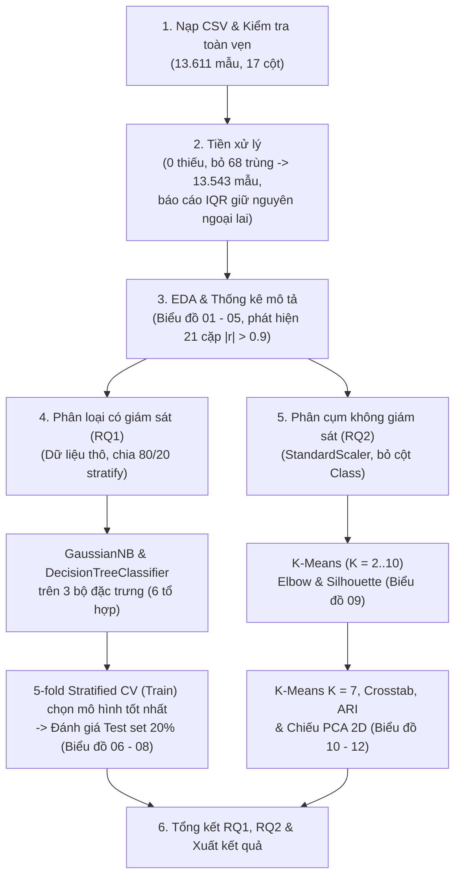

# Khai phá Dữ liệu - Phân loại và Phân cụm Đậu khô (Dry Bean Dataset)


-2EA44F)

> **Tóm tắt mục tiêu:** Xây dựng pipeline khai phá dữ liệu (*Data Mining Pipeline*) hoàn chỉnh và có tính tái lập 100% từ khâu nạp dữ liệu, tiền xử lý (kiểm tra khuyết thiếu, lọc trùng lặp, phát hiện ngoại lai bằng IQR), phân tích khám phá dữ liệu (EDA đơn biến và đa biến), đến mô hình hóa học có giám sát (`GaussianNB`, `DecisionTreeClassifier`) và học không giám sát (`KMeans`, `PCA 2D`) trên tập dữ liệu *Dry Bean Dataset* (13.611 mẫu gốc, 16 đặc trưng hình thái, 7 giống đậu).

---

## 1. Thông tin chung

- **Học phần:** Khai thác dữ liệu và ứng dụng (`841447`)
- **Nhóm 9:** Trương Chí Long (`3123410198`) & Bùi Anh Đức (`3124720016`)
- **Giảng viên hướng dẫn:** Nguyễn Thanh Phước
- **Đơn vị:** Trường Đại học Sài Gòn (SGU)

---

## 2. Kiến trúc & Cấu trúc dự án

### 2.1. Cấu trúc cây thư mục

```text
Data-Mining-09/
├── dry_beans.csv                 # Dữ liệu gốc Dry Bean Dataset (13.611 dòng × 17 cột)
├── main.py                       # Script thực thi duy nhất chạy trọn luồng toàn bộ pipeline (PEP 8)
├── dry_beans.ipynb               # Jupyter Notebook báo cáo tương tác hoàn chỉnh (mã nguồn, số liệu & 12 biểu đồ inline)
├── README.md                     # Tài liệu tổng quan dự án, kết quả thực nghiệm và hướng dẫn chạy
└── outputs/                      # Thư mục ảnh đầu ra tự động tạo, chứa 12 biểu đồ PNG chuẩn 300 DPI
    ├── 01_phan_bo_lop.png
    ├── 02_histogram_dac_trung.png
    ├── 03_boxplot_ngoai_lai.png
    ├── 04_ma_tran_tuong_quan.png
    ├── 05_boxplot_theo_lop.png
    ├── 06_confusion_matrix.png
    ├── 07_so_sanh_mo_hinh.png
    ├── 08_feature_importances.png
    ├── 09_elbow_silhouette.png
    ├── 10_crosstab_cum_lop.png
    ├── 11_pca_cum.png
    └── 12_pca_lop_that.png
```

**Vai trò các thành phần cốt lõi:**
- [`dry_beans.csv`](dry_beans.csv): Tệp dữ liệu đầu vào gồm 13.611 mẫu hạt đậu khô với 16 thuộc tính hình thái số và 1 cột nhãn `Class` phân biệt 7 giống đậu.
- [`main.py`](main.py): Tệp mã nguồn Python độc lập duy nhất điều phối tuần tự toàn bộ 6 giai đoạn xử lý dữ liệu, chuẩn hóa theo quy chuẩn PEP 8 (độ dài dòng $\le 88$ ký tự, đầy đủ docstring tiếng Việt).
- [`dry_beans.ipynb`](dry_beans.ipynb): Sổ tay Jupyter Notebook trình bày trực quan kết hợp phần giải thích học thuật, mã nguồn thực thi từng bước và toàn bộ 12 biểu đồ nhúng inline sẵn sàng chạy trên JupyterLab hoặc Google Colab.
- `outputs/`: Thư mục chứa 12 biểu đồ phân tích trực quan ở độ phân giải 300 DPI phục vụ đánh giá và trình bày báo cáo.

### 2.2. Luồng xử lý dữ liệu (Data Pipeline)



### 2.3. Môi trường & Công nghệ

| Thành phần | Công nghệ / Thư viện | Vai trò trong dự án |
|---|---|---|
| Ngôn ngữ lập trình | **Python 3.10+** | Ngôn ngữ triển khai chính toàn bộ pipeline và notebook |
| Thư viện chuẩn Python | `os`, `sys`, `warnings` | Kiểm tra tệp, tạo thư mục `outputs/`, dừng an toàn `sys.exit(1)` khi thiếu file/cột |
| Xử lý dữ liệu & Toán học | **Pandas**, **NumPy** | Đọc CSV, lọc trùng lặp, tính phân vị IQR, thống kê mô tả, ma trận tương quan |
| Học máy (Machine Learning) | **Scikit-Learn** | `GaussianNB`, `DecisionTreeClassifier`, `KMeans`, `StandardScaler`, `PCA`, `train_test_split`, `StratifiedKFold`, `cross_validate`, `classification_report`, `confusion_matrix`, `silhouette_score`, `adjusted_rand_score` |
| Trực quan hóa | **Matplotlib**, **Seaborn** | Style `seaborn-v0_8-whitegrid`, font `DejaVu Sans`, bảng màu `tab10`, xuất ảnh PNG 300 DPI |

---

## 3. Hai câu hỏi nghiên cứu cốt lõi (Research Questions)

| Mã | Loại bài toán | Câu hỏi nghiên cứu | Phương pháp giải quyết |
|---|---|---|---|
| **RQ1** | **Phân loại** (*Supervised*) | Dựa vào nhóm đặc trưng nào — **kích thước** (`Area`, `Perimeter`, ...) hay **hình dạng** (`roundness`, `ShapeFactor`, ...) — để xác định loại đậu chính xác hơn? | • Phân chia tập Train/Test tỷ lệ `80/20` có `stratify=y` và `RANDOM_STATE = 42` (bảo toàn dữ liệu thô, tuyệt đối không chuẩn hóa cho Naive Bayes và Decision Tree).<br>• Tách 16 đặc trưng thành **Nhóm Kích thước (8 đặc trưng)**: `Area`, `Perimeter`, `MajorAxisLength`, `MinorAxisLength`, `AspectRation`, `Eccentricity`, `ConvexArea`, `EquivDiameter` và **Nhóm Hình dạng (8 đặc trưng)**: `Extent`, `Solidity`, `roundness`, `Compactness`, `ShapeFactor1`, `ShapeFactor2`, `ShapeFactor3`, `ShapeFactor4`.<br>• Huấn luyện **6 tổ hợp** (2 thuật toán `GaussianNB`, `DecisionTreeClassifier` $\times$ 3 bộ đặc trưng: *Toàn bộ 16*, *Kích thước 8*, *Hình dạng 8*) và đánh giá bằng **5-fold Stratified CV** trên tập Train.<br>• Chọn mô hình tối ưu nhất theo **F1-macro CV trung bình**, sau đó đánh giá khách quan một lần trên tập Test (20%) kèm phân tích `feature_importances_` (Gini Importance). |
| **RQ2** | **Phân cụm** (*Unsupervised*) | Số cụm tối ưu của **K-Means** là bao nhiêu, và các cụm tìm được có khớp với **7 loại đậu thật** không? | • Chuẩn hóa toàn bộ 16 đặc trưng số trên `13.543` mẫu sạch bằng `StandardScaler` (tuyệt đối tách cột `Class` khỏi đầu vào thuật toán).<br>• Chạy `KMeans` (`n_init=10`, `random_state=42`) với số cụm $K \in [2..10]$.<br>• Xác định $K$ tối ưu bằng phương pháp **Elbow (Inertia/WCSS)** và **Silhouette Score**.<br>• Đối chiếu cấu trúc phân cụm tại mốc $K = 7$ với 7 giống đậu thực tế qua ma trận chéo **Crosstab**, chỉ số **Adjusted Rand Index (ARI)** và giảm chiều **PCA 2D** để trực quan hóa mức độ phân tách. |

---

## 4. Tóm tắt kết quả thực nghiệm chính

> Toàn bộ số liệu bên dưới được trích xuất trực tiếp từ quá trình thực thi thực tế của [`main.py`](main.py) và [`dry_beans.ipynb`](dry_beans.ipynb), định dạng chuẩn 4 chữ số thập phân (`.4f`).

### 4.1. Thống kê dữ liệu, Tiền xử lý & Phân tích tương quan (EDA)
- **Dữ liệu gốc:** `13.611` mẫu $\times$ `17` cột (`16` đặc trưng số: 2 `int64`, 14 `float64`; `1` cột nhãn `Class` gồm 7 lớp: `DERMASON` 3.546 [26,05%], `SIRA` 2.636 [19,37%], `SEKER` 2.027 [14,89%], `HOROZ` 1.928 [14,17%], `CALI` 1.630 [11,98%], `BARBUNYA` 1.322 [9,71%], `BOMBAY` 522 [3,84%]).
- **Làm sạch dữ liệu:**
  - Giá trị khuyết thiếu (NaN): **0** giá trị thiếu.
  - Dữ liệu trùng lặp: Phát hiện và loại bỏ **68 dòng trùng lặp hoàn toàn** (toàn bộ thuộc lớp `HOROZ`, giảm còn 1.860 mẫu), còn lại **13.543 mẫu sạch** (`Train = 10.834` mẫu [80,00%], `Test = 2.709` mẫu [20,00%]).
- **Phát hiện ngoại lai bằng IQR ($1.5 \times \text{IQR}$):**
  - Ghi nhận **3.004 / 13.543 mẫu (22,18%)** có ít nhất 1 đặc trưng vượt ngưỡng IQR (cao nhất ở `Eccentricity`: 833 mẫu [6,15%], `Solidity`: 774 mẫu [5,72%], `ShapeFactor4`: 760 mẫu [5,61%], `MinorAxisLength`: 567 mẫu [4,19%], `Area`: 551 mẫu [4,07%]; thấp nhất ở `ShapeFactor2`: 0 mẫu [0,00%]).
  - **Quyết định xử lý:** **Tuyệt đối giữ nguyên 100% mẫu ngoại lai** vì các điểm vượt biên IQR toàn cục phản ánh sự biến thiên sinh học tự nhiên giữa các giống đậu kích thước lớn (`BOMBAY`) và giống hạt nhỏ (`DERMASON`), không phải lỗi đo lường.
- **Đa cộng tuyến cao ($|r| > 0.9$):** Phát hiện **21 cặp đặc trưng** có tương quan Pearson rất mạnh, nổi bật nhất là `Area` – `ConvexArea` ($r = 0.9999$), `Compactness` – `ShapeFactor3` ($r = 0.9987$), `Perimeter` – `EquivDiameter` ($r = 0.9915$) và `AspectRation` – `Compactness` ($r = -0.9876$).

### 4.2. Kết quả RQ1: Phân loại 7 giống đậu khô

#### Bảng so sánh 6 tổ hợp mô hình (5-fold Stratified CV trên Train & Kiểm chứng trên Test)

| Thuật toán | Bộ đặc trưng | F1-macro CV (5-fold) | Accuracy CV (5-fold) | Test Accuracy | Test F1-macro |
|---|---|---:|---:|---:|---:|
| `GaussianNB` | Toàn bộ (16 đặc trưng) | `0.7632 ± 0.0085` | `0.7620 ± 0.0073` | `0.7630` | `0.7669` |
| `GaussianNB` | Kích thước (8 đặc trưng) | `0.7625 ± 0.0080` | `0.7612 ± 0.0068` | `0.7619` | `0.7659` |
| `GaussianNB` | Hình dạng (8 đặc trưng) | `0.9062 ± 0.0067` | `0.8916 ± 0.0082` | `0.8915` | `0.9060` |
| `Decision Tree` | Toàn bộ (16 đặc trưng) | `0.9107 ± 0.0046` | `0.8960 ± 0.0058` | `0.8955` | `0.9098` |
| `Decision Tree` | Kích thước (8 đặc trưng) | `0.8878 ± 0.0056` | `0.8756 ± 0.0055` | `0.8808` | `0.8920` |
| **`Decision Tree`** | **Hình dạng (8 đặc trưng)** | **`0.9128 ± 0.0072`** | **`0.8984 ± 0.0072`** | **`0.8963`** | **`0.9099`** |

#### Đánh giá chi tiết trên Tập kiểm tra (Test Set = 2.709 mẫu) của mô hình tốt nhất (`Decision Tree - Hình dạng`)

| Lớp (`Class`) | Precision | Recall | F1-Score | Support |
|---|---:|---:|---:|---:|
| `BARBUNYA` | `0.9023` | `0.8717` | `0.8868` | 265 |
| `BOMBAY` | `1.0000` | `1.0000` | `1.0000` | 104 |
| `CALI` | `0.8820` | `0.9172` | `0.8992` | 326 |
| `DERMASON` | `0.9046` | `0.8956` | `0.9001` | 709 |
| `HOROZ` | `0.9270` | `0.9220` | `0.9245` | 372 |
| `SEKER` | `0.9293` | `0.9384` | `0.9338` | 406 |
| `SIRA` | `0.8239` | `0.8254` | `0.8246` | 527 |
| **Accuracy / Macro Avg** | **`0.9099`** | **`0.9101`** | **`0.8963` / `0.9099`** | **2.709** |

- **Phân tích lỗi nhầm lẫn & Trọng số đặc trưng:**
  - Giống `BOMBAY` đạt độ chính xác tuyệt đối `1.0000` ($104/104$ mẫu); cặp lớp nhầm lẫn nhiều nhất là `DERMASON` $\leftrightarrow$ `SIRA` với tổng **116 mẫu nhầm lẫn 2 chiều** (`DERMASON` $\rightarrow$ `SIRA`: 65 mẫu; `SIRA` $\rightarrow$ `DERMASON`: 51 mẫu).
  - Trên mô hình Decision Tree toàn bộ 16 đặc trưng, **Nhóm Hình dạng chiếm `0.5995` (59,95%)** tổng Gini Importance, gấp **1,50 lần** so với **Nhóm Kích thước (`0.4005` / 40,05%)**. Top 5 đặc trưng quan trọng nhất: `ShapeFactor1` (`0.2293`), `Compactness` (`0.1883`), `MajorAxisLength` (`0.1827`), `Perimeter` (`0.1517`), `roundness` (`0.0730`).
- **Kết luận RQ1:** **Nhóm đặc trưng Hình dạng** chiếm ưu thế rõ rệt trong việc xác định loại đậu (tăng **+14,37%** F1-macro CV trên `GaussianNB` và **+2,50%** F1-macro CV trên `Decision Tree`), nhờ các tỷ lệ hình thái không thứ nguyên mang tính ổn định di truyền cao theo từng giống đậu.

### 4.3. Kết quả RQ2: Phân cụm không giám sát K-Means & Đối chiếu PCA 2D

#### Kết quả K-Means theo số cụm $K \in [2..10]$ (trên 13.543 mẫu chuẩn hóa `StandardScaler`)

| Số cụm ($K$) | Inertia (WCSS) | Silhouette Score | Ghi chú |
|---:|---:|---:|---|
| 2 | `129194.0199` | `0.3972` | Tách hai nhóm lớn/nhỏ cơ bản |
| **3** | **`94331.7346`** | **`0.4044`** | **Số cụm $K$ tối ưu (Silhouette đạt cực đại, điểm gãy Elbow)** |
| 4 | `75993.1949` | `0.3423` | Đường cong Elbow bắt đầu thoải dần |
| 5 | `61624.6374` | `0.3572` | Độ dốc giảm Inertia phẳng dần từ $K = 3..5$ |
| 6 | `54900.7483` | `0.3599` | |
| **7** | **`48671.4570`** | **`0.3088`** | **Mốc đối chiếu tương ứng 7 lớp thực tế ($\text{ARI} = 0.6669$)** |
| 8 | `45083.3590` | `0.3027` | |
| 9 | `41904.8161` | `0.3029` | |
| 10 | `39707.1259` | `0.2681` | Phân mảnh cụm, Silhouette giảm mạnh |

- **Độ khớp với 7 lớp thật tại $K = 7$:**
  - Chỉ số **Adjusted Rand Index (ARI) đạt `0.6669`**, khẳng định mức độ tương thích khá cao giữa phân cụm không giám sát và phân loại sinh học thực tế.
  - Độ tinh khiết nổi bật trên từng cụm: `Cụm 3` $\rightarrow$ `BOMBAY` (**100,00%** thuần nhất, bao phủ 99,62% lớp); `Cụm 2` $\rightarrow$ `HOROZ` (**93,83%**); `Cụm 0` $\rightarrow$ `DERMASON` (**92,21%**); `Cụm 5` $\rightarrow$ `SEKER` (**92,18%**); `Cụm 6` $\rightarrow$ `SIRA` (**74,71%**, có giao thoa với 499 mẫu `DERMASON`); trong khi `Cụm 4` gom chung hai giống hạt lớn bầu dục `CALI` (1.302 mẫu) và `BARBUNYA` (1.141 mẫu).
- **Không gian giảm chiều PCA 2D:** Thành phần chính `PC1` giải thích **55,55%** phương sai và `PC2` giải thích **26,36%** phương sai (**tổng cộng `81,91%`** phương sai dữ liệu 16 chiều).
- **Kết luận RQ2:** Số cụm tối ưu tự nhiên của K-Means là **$K = 3$** (`Silhouette = 0.4044`), hội tụ về 3 đại nhóm hình thái (hạt khổng lồ, hạt lớn/thuôn dài, hạt vừa và nhỏ). Tại $K = 7$, các cụm khớp khá tốt với 7 giống đậu thật (`ARI = 0.6669`), tái tạo thuần khiết $4/7$ giống đậu riêng biệt.

---

## 5. Danh mục 12 biểu đồ trực quan hóa trong `outputs/`

Toàn bộ biểu đồ được xuất dưới định dạng PNG ở độ phân giải **300 DPI** (`bbox_inches="tight"`), sử dụng style `seaborn-v0_8-whitegrid`, font `DejaVu Sans` và bảng màu `tab10` đồng nhất theo lớp.

| STT | Tên file trong `outputs/` | Nhóm | Nội dung & Ý nghĩa phân tích |
|---:|---|---|---|
| 01 | [`outputs/01_phan_bo_lop.png`](outputs/01_phan_bo_lop.png) | Tổng quan EDA | Biểu đồ cột phân bố số lượng mẫu của 7 lớp đậu sạch kèm nhãn số đếm trên đầu cột, thể hiện sự chênh lệch tự nhiên giữa `DERMASON` (3.546) và `BOMBAY` (522). |
| 02 | [`outputs/02_histogram_dac_trung.png`](outputs/02_histogram_dac_trung.png) | Đơn biến EDA | Lưới $4 \times 4$ Histogram kết hợp đường cong KDE cho 16 đặc trưng số, nhận diện độ lệch phải của nhóm Kích thước và phân bố đa đỉnh của các hệ số Hình dạng. |
| 03 | [`outputs/03_boxplot_ngoai_lai.png`](outputs/03_boxplot_ngoai_lai.png) | Đơn biến EDA | Lưới $4 \times 4$ Boxplot cho 16 đặc trưng số, trực quan hóa 3.004 mẫu ngoại lai IQR (22,18%) làm cơ sở khoa học cho quyết định giữ nguyên ngoại lai tự nhiên. |
| 04 | [`outputs/04_ma_tran_tuong_quan.png`](outputs/04_ma_tran_tuong_quan.png) | Đa biến EDA | Heatmap ma trận tương quan Pearson (bảng màu `coolwarm`, giá trị làm tròn 2 chữ số thập phân), phơi bày 21 cặp đa cộng tuyến cao ($|r| > 0.9$). |
| 05 | [`outputs/05_boxplot_theo_lop.png`](outputs/05_boxplot_theo_lop.png) | Đa biến EDA | So sánh phân bố 3 đặc trưng tiêu biểu (`Area`, `AspectRation`, `ShapeFactor1`) qua 7 lớp đậu, minh họa khả năng tách lớp của từng nhóm đặc trưng. |
| 06 | [`outputs/06_confusion_matrix.png`](outputs/06_confusion_matrix.png) | Phân loại (RQ1) | Heatmap ma trận nhầm lẫn (bảng màu `Blues`) trên tập Test 2.709 mẫu của mô hình tốt nhất (`Decision Tree - Hình dạng`), cho thấy `BOMBAY` đạt 100% và vùng nhầm lẫn chính giữa `DERMASON` – `SIRA`. |
| 07 | [`outputs/07_so_sanh_mo_hinh.png`](outputs/07_so_sanh_mo_hinh.png) | Phân loại (RQ1) | Biểu đồ cột nhóm so sánh hiệu năng giữa `GaussianNB` và `Decision Tree` theo Nhóm Kích thước và Nhóm Hình dạng, làm nổi bật bước nhảy +14,37% trên `GaussianNB`. |
| 08 | [`outputs/08_feature_importances.png`](outputs/08_feature_importances.png) | Phân loại (RQ1) | Biểu đồ cột ngang xếp hạng `feature_importances_` (Gini Importance) của Decision Tree, chứng minh vai trò quyết định của các đặc trưng hình dạng như `ShapeFactor1`. |
| 09 | [`outputs/09_elbow_silhouette.png`](outputs/09_elbow_silhouette.png) | Phân cụm (RQ2) | Biểu đồ kép đường cong Elbow (Inertia) và Silhouette Score theo $K \in [2..10]$, đánh dấu $K = 3$ tối ưu (`0.4044`) và đối chiếu mốc $K = 7$ (`0.3088`). |
| 10 | [`outputs/10_crosstab_cum_lop.png`](outputs/10_crosstab_cum_lop.png) | Phân cụm (RQ2) | Heatmap ma trận chéo (Crosstab) đối chiếu 7 cụm K-Means với 7 lớp đậu thật, minh họa độ tinh khiết vượt trội của `BOMBAY`, `HOROZ`, `DERMASON`, `SEKER` và sự gom cụm `CALI` – `BARBUNYA`. |
| 11 | [`outputs/11_pca_cum.png`](outputs/11_pca_cum.png) | Phân cụm (RQ2) | Biểu đồ phân tán 7 cụm K-Means và tâm cụm (`X`) chiếu lên không gian PCA 2D (bảo toàn 81,91% phương sai). |
| 12 | [`outputs/12_pca_lop_that.png`](outputs/12_pca_lop_that.png) | Phân cụm (RQ2) | Biểu đồ phân tán 7 lớp đậu thật trên cùng không gian PCA 2D, đối chiếu trực tiếp với `11_pca_cum.png` để kiểm chứng mức độ tương đồng phân bố ($\text{ARI} = 0.6669$). |

---

## 6. Hướng dẫn cài đặt & Tái lập thực nghiệm (Reproducibility)

### 6.1. Yêu cầu môi trường & Cài đặt thư viện
Đảm bảo hệ thống đã cài đặt **Python 3.10 trở lên**, sau đó cài đặt các thư viện cần thiết bằng lệnh:

```bash
pip install pandas numpy scikit-learn matplotlib seaborn
```

### 6.2. Chuẩn bị tệp dữ liệu
Đặt tệp dữ liệu gốc **`dry_beans.csv`** vào ngay thư mục gốc của dự án (cùng cấp với [`main.py`](main.py) và [`dry_beans.ipynb`](dry_beans.ipynb)). Chương trình sẽ tự kiểm tra sự tồn tại và tính đầy đủ 17 cột; nếu có lỗi sẽ dừng an toàn với mã thoát `1` kèm hướng dẫn tiếng Việt.

### 6.3. Thực thi chương trình

- **Cách 1 — Chạy script Python duy nhất (`main.py`):**
  ```bash
  python main.py
  ```
  *Lưu ý:* Ở chế độ mặc định, `main.py` sẽ hiển thị lần lượt các cửa sổ biểu đồ EDA (`01` – `05`) qua `plt.show()` — đóng từng cửa sổ để chạy tiếp các bước mô hình hóa và xuất 12 ảnh vào `outputs/`. Nếu chạy trong môi trường server/headless không cần mở cửa sổ GUI:
  ```powershell
  # Windows PowerShell
  $env:MPLBACKEND="Agg"; python main.py
  ```
  ```bash
  # Linux / macOS
  MPLBACKEND=Agg python main.py
  ```

- **Cách 2 — Chạy tương tác bằng Jupyter Notebook (`dry_beans.ipynb`):**
  Mở tệp [`dry_beans.ipynb`](dry_beans.ipynb) bằng **JupyterLab**, **VS Code** hoặc tải lên **Google Colab** (upload kèm `dry_beans.csv` vào thư mục làm việc) và chọn **Run All** để thực thi từng khối phân tích cùng 12 biểu đồ hiển thị trực tiếp inline.

### 6.4. Cam kết tính tất định & Tái lập 100%
Mọi thao tác mang tính ngẫu nhiên trong toàn bộ pipeline đều được cố định cùng một hạt giống **`RANDOM_STATE = 42`**:
- Chia tập dữ liệu 80/20 có phân tầng (`train_test_split(..., stratify=y, random_state=42)`).
- Kiểm định chéo 5-fold (`StratifiedKFold(n_splits=5, shuffle=True, random_state=42)`).
- Cây quyết định (`DecisionTreeClassifier(random_state=42)`).
- Phân cụm K-Means (`KMeans(..., random_state=42, n_init=10)`).
- Giảm chiều trực quan hóa (`PCA(n_components=2, random_state=42)`).

Khi chạy lại `python main.py` qua các lần chạy độc lập, toàn bộ **961 dòng output console** và mọi chỉ số thực nghiệm đều trùng khớp **100%** không sai lệch.

---

## 7. Nguồn Tham khảo & Kế thừa (References & Inheritance)

1. **Bài báo khoa học gốc công bố bộ dữ liệu (*Dry Bean Dataset*):**
   - Koklu, M., & Ozkan, I. A. (2020). *Multiclass classification of dry beans using computer vision and machine learning techniques*. **Computers and Electronics in Agriculture**, 174, 105507. DOI: [10.1016/j.compag.2020.105507](https://doi.org/10.1016/j.compag.2020.105507).
2. **Kho lưu trữ dữ liệu chuẩn (UCI Machine Learning Repository):**
   - Dry Bean Dataset (ID: 602) — [https://archive.ics.uci.edu/dataset/602/dry+bean+dataset](https://archive.ics.uci.edu/dataset/602/dry+bean+dataset).
3. **Tài liệu kỹ thuật và thuật toán mã nguồn mở được kế thừa:**
   - **Scikit-Learn:** Pedregosa et al. (2011), *Scikit-learn: Machine Learning in Python*, JMLR 12, pp. 2825–2830 (hiện thực chuẩn hóa `StandardScaler`, `GaussianNB`, `DecisionTreeClassifier`, `KMeans`, `PCA`, `StratifiedKFold`, Silhouette & ARI).
   - **Pandas & NumPy:** McKinney, W. (2010) & Harris, C. R. et al. (2020) cho xử lý bảng dữ liệu và tính toán đại số mảng.
   - **Matplotlib & Seaborn:** Hunter, J. D. (2007) & Waskom, M. L. (2021) cho trực quan hóa thống kê chuẩn học thuật.
4. **Quy chuẩn mã nguồn:** Tuân thủ chuẩn định dạng **PEP 8** (*Style Guide for Python Code*).
